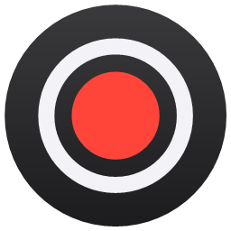
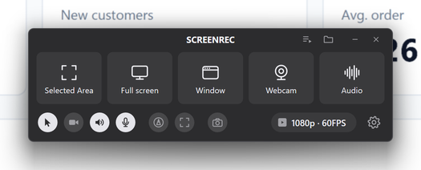
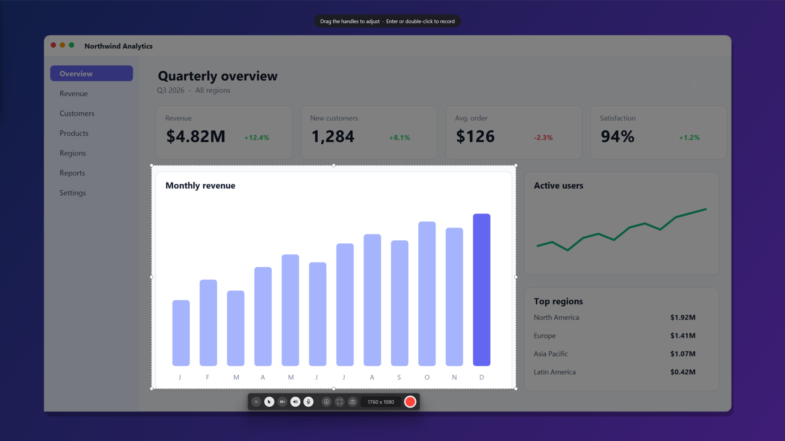
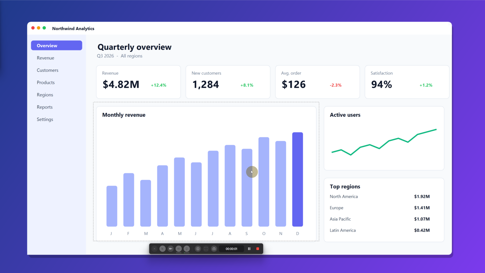
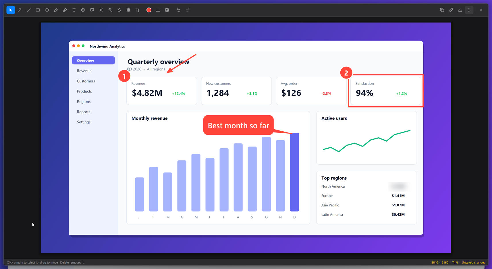
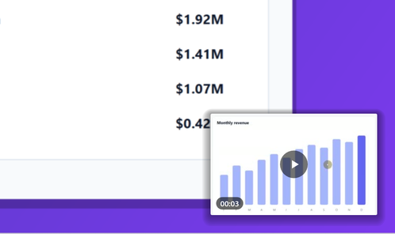
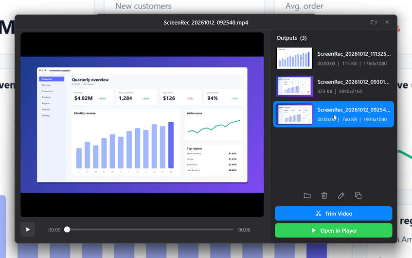
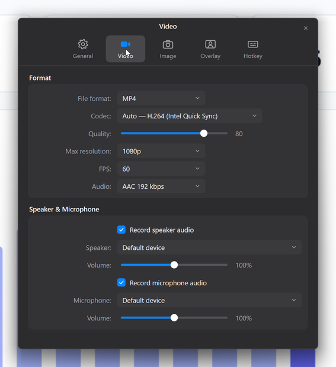
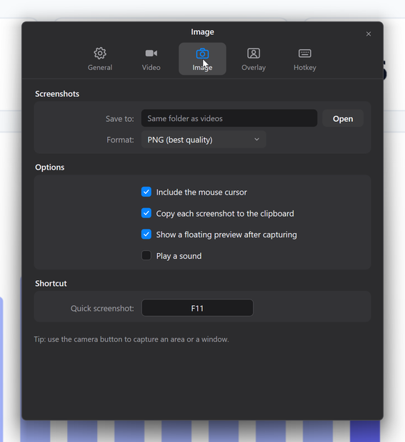

<p align="center">
  
</p>

<h1 align="center">ScreenRec</h1>

<p align="center">
  A fast, lightweight screen recorder and screenshot tool for Windows, with a clean UI inspired by Bandicam for Mac.<br>
  Native C++ · GPU-accelerated · ~1 MB app · free and open source
</p>

<p align="center">
  <a href="https://github.com/MurbX/screenrecorder/releases/latest"><b>⬇ Download for Windows</b></a> ·
  <a href="#features">Features</a> ·
  <a href="#building-from-source">Build</a> ·
  <a href="CONTRIBUTING.md">Contribute</a>
</p>

<p align="center">
  
</p>

## Features

### Recording
- **Five modes:** selected area, full screen, a window, webcam only, or audio only.
- **Record a 4K screen at 1080p** (or 720p, 1440p, original…) at up to 60 FPS. Encoding runs on your GPU
  (NVIDIA NVENC, Intel Quick Sync, AMD AMF) with an automatic CPU fallback.
- **System audio and microphone** with live level meters, volume up to 200%.
- **Pause / resume**, a countdown, and global hotkeys.
- **Multi-monitor aware:** pick which screen to record, works across screens with different scaling.
- ScreenRec's own windows never appear in your recordings.

<p align="center">
  
</p>

### Cursor, webcam and drawing
- **Yellow cursor highlight and click ripples**, recorded with zero lag.
- **Webcam overlay** as a draggable circle (or rounded rectangle), mirrored, with shadow and border.
- **Draw while recording:** pen, highlighter, arrows, shapes and text.

<p align="center">
  
</p>

### Screenshots and markup
- **Capture an area, a window or a full screen** instantly (F11 for a quick shot).
- A **floating preview** appears after every capture, like on macOS: **drag it straight into a chat,
  a browser or a folder**, or click it to open it.
- **Built-in editor:** arrows, lines, rectangles, ellipses, pen, highlighter, text, numbered steps,
  callouts, spotlight, magnifier, blur and pixelate (to hide private info), crop, undo/redo.
  Copy the image, copy its path, save, or drag it out.

<p align="center">
  
</p>

<p align="center">
  
</p>

### Output and settings
- **Output window** with an embedded player, thumbnails, trim, rename, copy and delete.
- Settings for format (MP4/MKV), codec, quality, resolution, FPS, audio devices, overlays, screenshot
  format and folder, and hotkeys.

<p align="center">
  
</p>

<p align="center">
  
  
</p>

## Install

1. Download **`ScreenRec-Setup-x.y.z.exe`** from the [latest release](https://github.com/MurbX/screenrecorder/releases/latest).
2. Run it. No admin rights needed, and FFmpeg is included.

Windows may show a SmartScreen warning for new, unsigned apps: click **More info → Run anyway**.
A portable `.zip` is also available on each release.

**Updates:** ScreenRec checks for new versions once a day and offers to install them
(Settings → General → Updates). Upgrades keep your settings and recordings.

**Requirements:** Windows 10 version 2004 or newer, or Windows 11 (64-bit).

## Default hotkeys

| Action | Hotkey |
|---|---|
| Record / stop the screen under the mouse | `F12` (`Alt+F12` when Visual Studio's debugger reserves F12) |
| Record the active window | `Ctrl+F12` |
| Pause / resume | `Shift+F12` |
| Drawing tools | `Ctrl+Shift+D` |
| Quick screenshot | `F11` |

All hotkeys can be changed in Settings → Hotkey.

## Building from source

Requirements: Visual Studio 2022 or 2026 with the **Desktop development with C++** workload.

```powershell
git clone https://github.com/MurbX/screenrecorder.git
cd screenrecorder
powershell -ExecutionPolicy Bypass -File build.ps1
```

The app is built to `build\ScreenRec.exe`. Recording needs `ffmpeg.exe` next to it or on the PATH
(`winget install Gyan.FFmpeg`). See [CONTRIBUTING.md](CONTRIBUTING.md) for the project layout and
[docs/RELEASING.md](docs/RELEASING.md) for packaging the installer.

## How it works

ScreenRec is a native Win32 app: the UI is drawn with Direct2D/DirectWrite, overlays use
DirectComposition, audio is captured with WASAPI, and the webcam and video player use Media Foundation.
Screens are captured with the Desktop Duplication API and encoded by an
[FFmpeg](https://ffmpeg.org) process that ships with the app.

## License

ScreenRec is released under the [MIT License](LICENSE). The bundled FFmpeg is licensed under the GPLv3;
see [THIRD-PARTY-NOTICES.md](THIRD-PARTY-NOTICES.md).
